# 📘 MINDMESH-NEXUS — Complete Working Stage Workflow & Component Blueprint

> **System:** MINDMESH-NEXUS (Autonomous Voice AI Teaching Co-Pilot & Multimodal Learning Platform)  
> **Team:** The Big O  
> **Track:** AI-01 / HR26-AI-02: Learning Experiences  
> **Repository:** `https://github.com/hackering-2-0/HR2-OI-DA102E89` (Branch: `main`)

---

## 🗂️ 1. Complete Folder & Directory Architecture

```
MINDMESH-NEXUS/
├── backend/                              # FastAPI Python Backend Services & Endpoints
│   ├── routes/
│   │   ├── gemini_routes.py              # Google Gemini 3.8 Flash proxy & audio transcribe routes
│   │   ├── groq_routes.py                # Groq Cloud LPU Whisper & Llama-3.3 routes
│   │   ├── bhashini_routes.py            # Digital India Bhashini Indic ASR/TTS/Translate routes
│   │   ├── gnn_routes.py                 # Graph Neural Network graph topology & risk endpoints
│   │   ├── engineering_routes.py         # Engineering syllabus & concepts query routes
│   │   └── system_routes.py              # Health check & metrics telemetry routes
│   └── services/
│       ├── gemini_service.py             # Gemini client & multimodal audio transcription
│       ├── groq_service.py               # Groq LPU Whisper & fast intent parser
│       └── bhashini_service.py           # AI4Bharat Bhashini ULCA / Dhruva integration
├── data/                                 # Datasets, Syllabi & Knowledge Stores
│   ├── engineering_dataset.json          # VTU & CS Engineering concepts & prerequisite graph
│   └── mockData.ts                       # Pre-cached NCERT Grade 7 Science & CN lesson plans
├── models/                               # Fine-Tuned & Domain Models
│   └── engineering_instruct_model/       # Pre-trained engineering concept retrieval weights
├── src/                                  # React 18 + TypeScript Frontend
│   ├── components/                       # Modular UI Components & Workspaces
│   │   ├── Navbar.tsx                    # Top persona switcher, secondary command bar, 2FA profile
│   │   ├── VoiceCoPilotBar.tsx           # Voice Orb, human vocal meter, quick prompts, audio test
│   │   ├── AudioVisualizer.tsx           # Real-time HTML5 Canvas waveform animation
│   │   ├── LessonPlanView.tsx            # 3-Tier Lesson Studio (Tier 1 Scaffold, Tier 2 Core, Tier 3 Extension)
│   │   ├── PPTDocumentStudio.tsx         # Multi-format doc uploader, Flowchart DAG, Calendar sync & Q&A
│   │   ├── ConflictResolutionView.tsx    # Epistemic trust scores, NLI contradiction analysis & source lock
│   │   ├── LearnerRiskDashboard.tsx      # GNN/DKT learner risk radar, twin cards & intervention scheduler
│   │   ├── InteractiveKnowledgeGraph.tsx # Force-directed prerequisite concept graph & micro-lessons
│   │   ├── CurriculumMapView.tsx         # Hierarchical curriculum breakdown with branch/semester tabs
│   │   ├── CalendarView.tsx              # Interactive Classroom Planner with 1-click time slot sync
│   │   ├── StudentDashboard.tsx          # Student Socratic workspace with 4 interactive modalities
│   │   ├── StudentDeliveryModal.tsx      # Classroom delivery celebration modal with live link/QR
│   │   ├── ApprovalBar.tsx               # Sticky teacher governance & pedagogical review sign-off bar
│   │   ├── ExplainableAIChatBot.tsx      # Floating explainable AI assistant with step citations
│   │   ├── PageVoiceReader.tsx           # Full-page read-aloud drawer with Bhashini Indic voice
│   │   ├── HierarchicalCurriculumBreadcrumb.tsx # University > Scheme > Sem > Subject selector
│   │   ├── AuditTrailModal.tsx           # Full AI decision lineage, confidence & source audit trail
│   │   ├── AgnesConfigModal.tsx          # Agnes 3.0 Flash & Gemini hyperparameter tuner
│   │   ├── BhashiniConfigModal.tsx       # Bhashini API keys & Indic language switcher modal
│   │   ├── TeacherAuthModal.tsx          # Teacher PIN unlock modal
│   │   ├── AuthPortal.tsx                # WhatsApp 2FA SMS/OTP authentication portal
│   │   ├── MobileBottomNav.tsx           # Mobile thumb navigation dock with floating mic
│   │   ├── MobileQuickDrawer.tsx         # Mobile side drawer with fast prompts & audio controls
│   │   └── Footer.tsx                    # System status, active models & compliance badges
│   ├── services/                         # Client-Side Service Singletons & State Managers
│   │   ├── voiceService.ts               # Human voice bandpass DSP (85-3400Hz), 4-tier ASR & 200% TTS
│   │   ├── groqService.ts                # Groq Cloud LPU Whisper & Llama-3.3 client
│   │   ├── geminiService.ts              # Gemini 3.8 Flash multimodal grounding & intent client
│   │   ├── bhashiniService.ts            # Digital India Bhashini Indic speech synthesis & ASR
│   │   ├── agentEngine.ts                # Autonomous agentic decision executor & dispatch logic
│   │   ├── authService.ts                # 2FA session manager & role-based access control
│   │   ├── sharedStateManager.ts         # Multi-tab synchronized reactive event bus & local cache
│   │   └── curriculumState.ts            # Hierarchical university curriculum state manager
│   ├── types/
│   │   └── index.ts                      # Universal TypeScript interfaces & data contracts
│   ├── App.tsx                           # Main application controller, persona routing & global layout
│   ├── index.css                         # Tailwind CSS tokens, animations & glassmorphism utilities
│   └── main.tsx                          # React root DOM mounting point
├── docs/                                 # Full documentation & architectural blueprints
├── public/                               # Static assets, diagrams & favicon
├── test_api_suite.py                     # Automated backend verification test suite (22/22 Tests)
├── vite.config.ts                        # Vite build configuration & local dev server proxy
├── tailwind.config.js                    # Tailwind theme extensions & font definitions
├── package.json                          # NPM dependencies & scripts
├── requirements.txt                      # Python dependencies
├── Procfile                              # Render / Cloud deployment entrypoint
└── .env                                  # API keys & configuration environment variables
```

---

## 🔄 2. End-to-End Working Stage Workflow

```mermaid
flowchart TD
    %% STAGE 0
    S0["Stage 0: 2FA Authentication & Persona Initialization\n(AuthPortal.tsx -> authService.ts)"] --> S1
    
    %% STAGE 1
    S1["Stage 1: Microphone Capture & Human Voice Frequency DSP\n(voiceService.ts: 85Hz - 3400Hz Bandpass + 2.5x Gain)"] --> S2
    
    %% STAGE 2
    S2["Stage 2: 4-Tier Parallel Speech Recognition (ASR)\n(WebSpeech + Groq Whisper + Gemini Audio + Bhashini)"] --> S3
    
    %% STAGE 3
    S3["Stage 3: Intent Parsing & Autonomous Action Execution\n(agentEngine.ts: Calendar, Marks, Remedial Twin, Replan)"] --> S4
    
    %% STAGE 4
    S4["Stage 4: Whole-Curriculum Grounding & 3-Tier Scaffolding\n(Gemini 3.8 Flash 512K: Tier 1 Beginner, Tier 2 Core, Tier 3 Extension)"] --> S5
    
    %% STAGE 5
    S5["Stage 5: Epistemic Source Trust & Contradiction Resolution\n(Trust = 0.40R + 0.40A + 0.20C -> NCERT 2026 Locked Ground Truth)"] --> S6
    
    %% STAGE 6
    S6["Stage 6: GNN Prerequisite DAG & DKT Risk Radar\n(Predicts Student Gap 3-5 Days Before Exams)"] --> S7
    
    %% STAGE 7
    S7["Stage 7: Human-in-the-Loop Review & Teacher Sign-off\n(ApprovalBar.tsx: Teacher Review -> Deliver to Students)"] --> S8
    
    %% STAGE 8
    S8["Stage 8: Cross-Tab Reactive State Sync\n(sharedStateManager.ts -> Broadcasts to Student Workspace)"] --> S9
    
    %% STAGE 9
    S9["Stage 9: Multimodal Socratic Student Experience\n(StudentDashboard.tsx: Visual SVG, Text, Indic Voice Tutor, Quiz)"] --> S10

    %% STAGE 10
    S10["Stage 10: Document Studio & Flowchart Generator\n(PPTDocumentStudio.tsx: PPT/PDF -> Flowchart DAG -> Calendar Sync)"]
```



---

## 🔍 3. Deep Dive into Every Working Stage

### 🔑 Stage 0: Authentication & Role-Based Access Control (RBAC)
- **Component**: [`src/components/AuthPortal.tsx`](file:///c:/Users/india/OneDrive/Desktop/MINDMESH-NEXUS/src/components/AuthPortal.tsx)
- **Service**: [`src/services/authService.ts`](file:///c:/Users/india/OneDrive/Desktop/MINDMESH-NEXUS/src/services/authService.ts)
- **Workflow**:
  1. User enters mobile number / email and chooses role (**Teacher** or **Student**).
  2. System triggers a simulated WhatsApp 2FA SMS OTP (default demo OTP: `123456`).
  3. Upon OTP verification, `authService.login()` issues an authenticated session stored in browser `localStorage`.
  4. Teachers gain full access to the **3-Tier Studio, PPT Studio, Risk Radar, Knowledge Graph, and Approval Governance**.
  5. Students are routed to the **Student Socratic Workspace** with interactive learning modalities.

---

### 🎙️ Stage 1: Microphone Capture & Human Voice Frequency DSP
- **Service**: [`src/services/voiceService.ts`](file:///c:/Users/india/OneDrive/Desktop/MINDMESH-NEXUS/src/services/voiceService.ts)
- **Workflow**:
  1. User clicks the Mic Orb in [`VoiceCoPilotBar.tsx`](file:///c:/Users/india/OneDrive/Desktop/MINDMESH-NEXUS/src/components/VoiceCoPilotBar.tsx).
  2. `voiceService.startListening()` requests `navigator.mediaDevices.getUserMedia` with echo cancellation and noise suppression.
  3. Audio passes through a **Human Vocal Acoustic Filter Graph**:
     - **$80\text{ Hz}$ High-Pass Filter**: Cuts desk bumps, mechanical knocks, and AC rumble.
     - **$3,600\text{ Hz}$ Low-Pass Filter**: Removes high-frequency hiss, coil whine, and typing noise.
     - **$+4.5\text{ dB}$ Peaking EQ ($2,200\text{ Hz}$)**: Boosts human speech formants and consonant clarity.
     - **$2.5\times$ Input Gain & Dynamic Compressor**: Amplifies quiet and normal speech automatically.
  4. Real-time **256-bin FFT Analyser** calculates energy in the **85 Hz – 3,400 Hz** human vocal band and drives the live decibel visualizer (`VOCAL LOCK 65%`).

---

### ⚡ Stage 2: 4-Tier Parallel Speech Recognition (ASR)
- **Services**: [`voiceService.ts`](file:///c:/Users/india/OneDrive/Desktop/MINDMESH-NEXUS/src/services/voiceService.ts), [`groqService.ts`](file:///c:/Users/india/OneDrive/Desktop/MINDMESH-NEXUS/src/services/groqService.ts), [`geminiService.ts`](file:///c:/Users/india/OneDrive/Desktop/MINDMESH-NEXUS/src/services/geminiService.ts), [`bhashiniService.ts`](file:///c:/Users/india/OneDrive/Desktop/MINDMESH-NEXUS/src/services/bhashiniService.ts)
- **Workflow**:
  1. While the user speaks, **WebSpeech API** provides instant word-by-word streaming text.
  2. In parallel, `MediaRecorder` buffers the studio-filtered audio chunks.
  3. On speech finish (`stopListening`), a 4-tier parallel race resolves across:
     - **Groq Cloud Whisper v3** ($<300\text{ms}$)
     - **Google Gemini 3.8 Flash Audio** ($<400\text{ms}$)
     - **Digital India Bhashini Indic ASR** (AI4Bharat Conformer for Hindi & Kannada)
     - **WebSpeech Final Transcript**
  4. The cleanest and highest-confidence transcript is returned to the agent engine.

---

### 🧠 Stage 3: Voice Intent Parsing & Autonomous Action Execution
- **Service**: [`src/services/agentEngine.ts`](file:///c:/Users/india/OneDrive/Desktop/MINDMESH-NEXUS/src/services/agentEngine.ts)
- **Workflow**:
  1. The transcript is processed by the NLU Intent Parser (Groq Llama-3.3 / Gemini 3.8 Flash).
  2. **Supported Voice Actions**:
     - 📅 **Schedule a Class**: *"Schedule class in 10 min on Computer Networks"* $\rightarrow$ Creates a new `CalendarEvent`, sets time to $+10\text{m}$, and injects it into `sharedState`.
     - 🎯 **Remedial Intervention**: *"Rahul is weak in Slow Start"* $\rightarrow$ Flags Rahul Sharma's Learning Twin as `High Risk`, updates his prerequisite gap, and schedules a 1-on-1 review.
     - 📝 **Edit Gradebook Marks**: *"Edit marks for Aarav to 9/10"* $\rightarrow$ Updates score to $90\%$, lowers his GNN risk score from $86\%$ to $22\%$, and shows confetti.
     - ⚡ **Dynamic 20m Replan**: *"The class is behind, reduce this to 20 minutes"* $\rightarrow$ Compresses the 40-minute plan into a high-yield 20-minute lesson.
     - ❓ **Voice Q&A**: Answers any pedagogical or technical question aloud using Bhashini IndicTTS.

---

### 📐 Stage 4: 3-Tier Pedagogical Scaffolding
- **Component**: [`src/components/LessonPlanView.tsx`](file:///c:/Users/india/OneDrive/Desktop/MINDMESH-NEXUS/src/components/LessonPlanView.tsx)
- **Workflow**:
  1. Gemini 3.8 Flash formats the curriculum topic into 3 simultaneous tiers:
     - 🟢 **Tier 1 (Beginner Scaffold)**: Concrete analogies (*"Plant Solar Kitchen"* where Chloroplast = Kitchen, Chlorophyll = Solar Chef, Sun/CO₂/Water = Ingredients) and bilingual vocabulary for struggling students.
     - 🔵 **Tier 2 (Standard Core)**: 5-phase structured NCERT classroom plan with teacher talking points and discussion prompts.
     - 🟣 **Tier 3 (Advanced Extension)**: Deep biochemical inquiries (Calvin cycle, photon excitation in PS II, stoichiometry) for high-aptitude learners.

---

### ⚖️ Stage 5: Epistemic Source Trust & Contradiction Resolution
- **Component**: [`src/components/ConflictResolutionView.tsx`](file:///c:/Users/india/OneDrive/Desktop/MINDMESH-NEXUS/src/components/ConflictResolutionView.tsx)
- **Workflow**:
  1. Analyzes all uploaded source documents (NCERT 2026 textbook, Wikipedia 2019, Old Curriculum Notes).
  2. Computes the mathematical Trust Score:
     $$\text{Trust Score} = 0.40 \times \text{Recency} + 0.40 \times \text{Authority} + 0.20 \times \text{Consensus}$$
  3. Evaluates Natural Language Inference (NLI) contradiction pairs (e.g., whether Chlorophyll $a$ vs $b$ is the primary reaction center).
  4. Automatically locks verified sources (**NCERT 2026 at $98.4\%$ Trust**) and flags outdated materials as **Excluded**.

---

### 🔮 Stage 6: GNN Prerequisite DAG & DKT Predictive Risk Radar
- **Components**: [`src/components/LearnerRiskDashboard.tsx`](file:///c:/Users/india/OneDrive/Desktop/MINDMESH-NEXUS/src/components/LearnerRiskDashboard.tsx), [`src/components/InteractiveKnowledgeGraph.tsx`](file:///c:/Users/india/OneDrive/Desktop/MINDMESH-NEXUS/src/components/InteractiveKnowledgeGraph.tsx)
- **Workflow**:
  1. Maps curriculum prerequisites as a Directed Acyclic Graph (DAG).
  2. GNN message-passing calculates downstream risk based on prerequisite mastery deficits.
  3. Deep Knowledge Tracing (DKT) tracks student quiz histories to predict risk **3 to 5 days before summative exams**.
  4. Teachers can inspect student cards (Aarav, Rohan, Priya) and trigger 1-click tailored micro-lessons.

---

### 📑 Stage 7: PPT & PDF Document Studio & Flowchart Generator
- **Component**: [`src/components/PPTDocumentStudio.tsx`](file:///c:/Users/india/OneDrive/Desktop/MINDMESH-NEXUS/src/components/PPTDocumentStudio.tsx)
- **Workflow**:
  1. Teacher uploads `.ppt`, `.pptx`, `.pdf`, `.docx`, or `.txt` file (or selects built-in sample decks).
  2. System parses the document into sequential **Module 1 ➔ Module 2 ➔ Module 3** prerequisite flowchart nodes with:
     - Slide & page ranges
     - Bloom's Taxonomy cognitive levels (*Understand, Apply, Analyze, Evaluate*)
     - Prerequisites and estimated teaching hours
  3. **1-Click "Sync All to Calendar"**: Automatically pushes all modules as scheduled sessions into [`CalendarView.tsx`](file:///c:/Users/india/OneDrive/Desktop/MINDMESH-NEXUS/src/components/CalendarView.tsx).
  4. **Document AI Q&A**: Teachers/students can ask questions and receive instant answers with slide/page citations.

---

### 🛡️ Stage 8: Human-in-the-Loop Governance & Delivery
- **Components**: [`src/components/ApprovalBar.tsx`](file:///c:/Users/india/OneDrive/Desktop/MINDMESH-NEXUS/src/components/ApprovalBar.tsx), [`src/components/StudentDeliveryModal.tsx`](file:///c:/Users/india/OneDrive/Desktop/MINDMESH-NEXUS/src/components/StudentDeliveryModal.tsx), [`src/components/AuditTrailModal.tsx`](file:///c:/Users/india/OneDrive/Desktop/MINDMESH-NEXUS/src/components/AuditTrailModal.tsx)
- **Workflow**:
  1. Generated or replanned lessons remain in a **Pending Human Review** state.
  2. Teacher inspects the AI Decision Audit Trail (confidence, prompt lineage, latency).
  3. Teacher clicks **"Approve & Deliver"** $\rightarrow$ Triggers celebratory confetti and opens the Student Delivery Modal with a shareable classroom link and QR code.

---

### 🧑‍🎓 Stage 9: Multimodal Socratic Student Workspace
- **Component**: [`src/components/StudentDashboard.tsx`](file:///c:/Users/india/OneDrive/Desktop/MINDMESH-NEXUS/src/components/StudentDashboard.tsx)
- **Workflow**:
  1. Students log into their personalized workspace and access the delivered lesson across 4 interactive modalities:
     - 🎨 **Visual Mode**: Interactive SVG diagrams of chloroplast anatomy and stomata guard cells.
     - 📖 **Text Mode**: Structured bilingual cards with definitions.
     - 🎙️ **Voice Mode**: Socratic voice tutor with sub-800ms conversational audio in English, Hindi, or Kannada.
     - 📝 **Quiz Mode**: Interactive formative checkpoint with live score computation that dynamically updates the teacher's GNN Risk Radar.

---

### 🔊 Stage 10: High-Audibility Voice Output (Mastering Chain)
- **Service**: [`src/services/voiceService.ts`](file:///c:/Users/india/OneDrive/Desktop/MINDMESH-NEXUS/src/services/voiceService.ts)
- **Workflow**:
  1. Speech output is synthesized via Digital India Bhashini (FastSpeech2 + HiFi-GAN) or WebSpeech.
  2. Audio stream is routed through the Web Audio API mastering chain:
     - **$+3.5\text{ dB}$ Vocal Presence Filter at $2.4\text{ kHz}$**: Ensures maximum intelligibility.
     - **$2.0\times$ Volume Multiplier ($200\%$ Gain Boost)**: Guarantees loud, clear playback.
     - **Dynamic Compressor Node**: Prevents audio distortion and speaker rattling.

---

## 🧪 4. Testing & Verification Guide

### 1. Run the Backend API Test Suite
```bash
python test_api_suite.py
```
*Executes all 22 backend endpoint tests (Bhashini, Groq, Gemini, GNN, Engineering concept queries, system status).*

### 2. Run the Frontend Build Check
```bash
npm run build
```
*Compiles TypeScript and bundles production assets with Vite.*

### 3. Start Local Development Servers
```bash
# Terminal 1: Backend FastAPI Server
python -m uvicorn backend.main:app --host 127.0.0.1 --port 8000 --reload

# Terminal 2: Frontend Vite Server
npm run dev
```
*Open [http://localhost:3001/](http://localhost:3001/) in your browser.*
